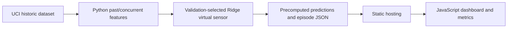

# MVP PRD — historical CO virtual sensor

Research/planning only. The selected product estimates **CO at time t** from concurrent PT08 and weather readings plus prior CO observations. It is a virtual-sensor nowcast, not a future forecast. The historical UCI data span March 2004–April 2005; source-time timezone and real sensor latency are unverified. No app is being built here. The selected Ridge model was selected by mean MAE over three rolling-origin validation folds. Its validation MAE is 0.197 vs persistence 0.495 (60.3% lower); common-row test MAE 0.281 vs 0.527 (46.7% lower). The same test period was viewed during earlier work and is not an independent untouched holdout. [Full methods and metrics](RESEARCH.md).

## Goals and limits

Show a working historical research demo that lets a student analyst inspect an estimate, reference reading, interval and candidate reason; let a reviewer inspect chronological model comparisons and baselines. Do not present estimates as live, as future forecasts, as AQI, as health guidance, or as confirmed pollution/fault diagnoses. Past CO observations are inputs; long outages limit the virtual sensor's applicability.

Personas: Ananya, student analyst, needs to inspect possible anomalies and missing-data evidence. Ravi, faculty reviewer, needs a clear model comparison, provenance, and a reproducible demonstration. Both are proposed personas.

## Acceptance criteria and screens

| View | Must ship and acceptance criteria |
|---|---|
| Dashboard | Historical badge, source/time range, selected Ridge virtual sensor, date controls, CO mg/m³ and missing-data counts. No current AQI or future forecast claim. |
| Estimate vs actual | Plot same-hour estimate, observed CO, interval and flagged hours; null actuals break the line. Clearly state sensors/weather at t and reference CO history through t−1. Seven-day default window, responsive layout and keyboard-readable values. |
| Episode timeline | Chronological list of all 29 exported episodes with severity and candidate class; filter by date; selecting one focuses the chart. Explicit empty state. |
| Episode detail | Show ID, inclusive start/end, duration, residual, all exported reasons, imputation and missing-history badges. State that causation and sensor fault are unverified. |
| Model performance | Show all eight framing/method combinations on three-fold mean validation and final test, each baseline and metric. Distinguish test previously viewed from new independent validation; display model selection criterion and n. |
| About | Source attribution, date bounds, wall-clock time semantics, uncertainty method, model limitations and links to [research](RESEARCH.md). |

For every view, loading/error/retry and keyboard focus must work; date-range changes update chart and list together. Validate data in-browser; never turn null into zero or convert source wall times into the viewer's timezone. At 375px no page-wide overflow. Target initial load within 3s and range change within 500ms on demo hardware; these are unmeasured targets.

## Scope

MVP: responsive dashboard, nowcast-versus-actual chart with interval, episode timeline and explanations, model comparison page, data/source details, static hosting, local fallback, testing, and rehearsal. No app scaffolding is included in this research task. Cut optional replay, animation, theme and advanced filters first; simplify detail to an inline card if behind. Preserve honest metrics, null handling, reasons, candidate labels and release rehearsal. Future: new sites, independently validated episodes, live ingestion, calibrated deployment uncertainty, long reference outages, conversion to ONNX, user accounts and alerts.

## Architecture and contract

Use React 19.3.0, Vite 8.3.x and Recharts 3.10.1 ([sources and versions](SOURCES.md)); confirm compatible dependencies when building. Offline Python requirements are pinned in research/requirements.txt. The app reads arrays from predictions.json and episodes.json plus summary.json and model_metadata.json; convert metrics.csv into JSON without recomputation. Each prediction has timestamp (source wall time, no timezone), actual number or null, predicted number, interval lower/upper/nominal_coverage, flagged, imputed_feature_count and prior_co_missing_hours. Each episode has unique id, inclusive start/end, hours, severity, classification, reason and peak_abs_residual. Both classifications are candidates. Fetch relative to the hosting base path. The saved pipeline metadata records framing=nowcast and horizon_hours=0.

## Testing, release and demo

- Rerun and verify artifacts; inspect lag provenance and training-only preprocessing; compare all eight methods using matching rows.
- Check JSON ordering, finite values, nulls, interval bounds, each episode reason and exact flagged-hour coverage; check all plotted values against source records.
- Test same-hour labels, source-time parsing, keyboard navigation, 375px view, empty/failure/retry states, and both candidate types.
- Prepare a GitHub Pages static build in a public repository using the [Vite deployment guide](https://vite.dev/guide/static-deploy.html), confirm base path and JSON fetches, and test in a clean browser. Keep a locally served copy and recording as fallbacks.
- Demo in six minutes: introduce historical scope (40s); inspect nowcast and interval (60s); show one example of each candidate classification (90s); explain validation/test baselines and limitations (85s); demonstrate missing data and interval coverage (45s); close with architecture and next steps (40s).

Risks: previously examined test and location-specific performance → independently validate later and present uncertainty; missing sensor/reference inputs → show missingness and use candidate explanations; deployment/network failure → local static copy and recording. Keep the original UCI research-use/licensing discrepancy in view ([UCI](https://archive.ics.uci.edu/dataset/360/air+quality)).

## 48-hour plan for four people

Roles: **P1 ML/data**, **P2 dashboard/charts**, **P3 episode views/integration**, **P4 deployment/testing/report/presentation**. This is a build plan, not work already performed. Each row is a four-hour wall-clock block; rest is deliberately scheduled. At kickoff all four read the data contract together. Keep status updates short and decide cuts at each checkpoint.

### Day 1 — T+0 to T+24

| Hours | P1 ML and data | P2 dashboard and charts | P3 episodes and integration | P4 deployment, tests and presentation |
|---|---|---|---|---|
| 0–4 | Reproduce artifacts; verify metrics; convert metrics CSV to JSON; freeze contract | Create future frontend project, dependency lock, shell and base styles | Inspect all episode fields; design list/detail with real export sample | Confirm Pages/repo access; acceptance checklist, review narrative and source attribution |
| 4–8 | Deliver signed-off artifact snapshot, model metadata and two demo IDs | Build chart with real actual/predicted/null values and interval | Implement episode list, detail reason and keyboard selection | Deploy initial static shell; test base-path asset fetching; write demo outline |
| 8–12 | Audit lag/rolling leakage and frontend readout values; resolve data questions | Wire date filter and cards to shared loaded data | Synchronize selected episode and chart range; implement timeline marks | Run first hosted end-to-end smoke test; log defects and assign owners |
| 12–16 | Freeze ML outputs; document modeling caveats and one example per class | Finish mobile layout, legend, loading and missing-data states | Finish inclusive joins, empty states and gap/quality labels | Build performance/source page with P1's table; rehearse draft narration |
| 16–20 | Buffer only for data blockers; then rest | Resolve critical chart errors; then rest | Resolve critical integration errors; then rest | Publish integrated snapshot; capture backup assets; then rest |
| 20–24 | Protected rest | Protected rest | Protected rest | Protected rest |

Checkpoints: **T+4 contract/dependencies locked**; **T+8 first deployed shell**; **T+12 real-data end-to-end path works**; **T+16 feature-complete core**, with optional work cut if any core criterion is missing. No further model experiments after T+16.

### Day 2 — T+24 to T+48

| Hours | P1 ML and data | P2 dashboard and charts | P3 episodes and integration | P4 deployment, tests and presentation |
|---|---|---|---|---|
| 24–28 | Independent numerical audit of displayed metrics/episodes | Polish readability, source-time labels, responsive chart | Test all episode selections, both classes, edge ranges and nulls | Full acceptance sweep on hosted build, organize defect list and report |
| 28–32 | Review explanations for overclaims; help data contract defects | Fix chart/mobile/performance defects; optional replay only if core green | Fix keyboard/empty/error cases; simplify drawer if needed | Test clean browser/device; prepare final slides, local package and recording plan |
| 32–36 | Sign off model/data snapshot and checksums | Resolve release blockers; stop new features at T+34 | Resolve release blockers; verify artifact version joins | Candidate release, data link audit and go/no-go at T+36 |
| 36–40 | Explain ML segment in full rehearsal; no tuning | Explain UI segment; fix only rehearsal blockers | Explain episode example; verify deterministic navigation | **Code freeze T+36. Full 6-minute rehearsal by T+38**, record backup, deploy verified release |
| 40–44 | Rest and prepare short model Q&A | Rest; retain local build | Rest; retain episode notes | Rest; verify backup files and review logistics |
| 44–48 | Final data sanity and demo support | Final local/host smoke, presentation readiness | Final selected-example check and presentation readiness | Final connectivity check, second timed run, open demo tabs; review at T+48 |

T+36 freeze allows only blocker fixes with P4's release checklist rerun. If a late fix risks the working demo, keep the frozen build. P4 owns release decisions; P1 signs data correctness; P2/P3 sign their flows. Each person has a four-hour protected rest block plus additional rest/buffer; reduce optional work rather than consuming all 48 hours continuously.

**MVP cut sequence:** replay → animations/theme → extra filters/brush → drawer replaced by inline card → arbitrary dates replaced by presets. The cut line is the single working path through real data, interval, episode explanation, truthful evaluation and deployment. If core integration is not working at T+12, all optional work stops immediately and P1/P4 help P2/P3 integrate.

## Six-minute review demo

| Time | Presenter and action | Point to establish |
|---|---|---|
| 0:00–0:40 | P4 opens hosted dashboard, reads historical label and project goal | Scope and actual provenance; no claim of current local AQI |
| 0:40–1:40 | P2 shows selected 7-day nowcast/actual/interval, hover and date change | Polished working frontend, same-hour virtual-sensor estimate and honest gaps |
| 1:40–3:10 | P3 selects one actual unusual-pollution candidate then one data-limitation candidate | Full rule explanations; candidate labels, no causal certainty |
| 3:10–4:35 | P1 opens Model page and points to splits, baselines and table | Real chronological experiments; Ridge selected on rolling validation; no inflated claims |
| 4:35–5:20 | P1 shows missingness/drift evidence and interval coverage | Why flags require caution and why data transparency matters |
| 5:20–6:00 | P4 explains static architecture, reproducibility and one next step | Deployable MVP and realistic roadmap; stop before seven minutes |

Before rehearsal, use actual IDs from episodes.json: pick a complete-input unusual candidate and a data-limitation candidate with a concise visible reason. If either example is unavailable after a legitimate rerun, update the demo script; never manufacture an event. Keep the same paths and saved views in the local backup.
