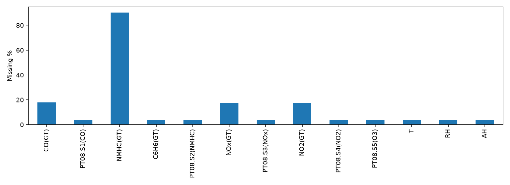

# Air quality prediction and episode detection — research

Phases 1–3 (domain, existing products, dataset findings) come from the planning-phase research. Phases 4–6 describe the
model and system that were built. The method is deliberately simple and follows the problem statement step by step.

## Phase 1 — domain and problem

Estimate current CO using concurrent low-cost sensor and weather readings, compare it with the later reference observation, and explain why a residual flag may reflect unusual pollution or limitations in the data. The operational action is investigation, not a health alert.

| Dataset quantity | Plain meaning and health relevance | Source |
|---|---|---|
| CO | Carbon monoxide, a gas that reduces oxygen delivery in the body. | [WHO](https://www.who.int/teams/environment-climate-change-and-health/air-quality-and-health/health-impacts/types-of-pollutants) |
| NMHC | Non-methane hydrocarbons: a mixture rather than a single chemical. Health effects depend on composition; no single health interpretation of this aggregate is supported. | [EPA VOC effects](https://www.epa.gov/indoor-air-quality-iaq/volatile-organic-compounds-impact-indoor-air-quality) |
| C6H6 | Benzene; exposure can harm blood-related systems and is carcinogenic. | [WHO benzene report](https://www.who.int/europe/publications/i/item/WHO-EURO-2023-8983-48755-72523) |
| NOx | Nitrogen oxides, including NO and NO2; do not treat total NOx as a NO2 concentration. | [EPA NO2](https://www.epa.gov/no2-pollution/basic-information-about-no2) |
| NO2 | Nitrogen dioxide; irritates airways and can aggravate asthma. | [EPA NO2](https://www.epa.gov/no2-pollution/basic-information-about-no2) |
| PT08 sensor responses | Electrical sensor responses, not pollutant mass concentrations. S5 is nominally ozone-targeted; there is no ozone reference target in this file. Temperature and humidities are environmental covariates. | [UCI variable definitions](https://archive.ics.uci.edu/dataset/360/air+quality) |

| Framework | What it communicates | Selected values / implication | Source |
|---|---|---|---|
| WHO 2021 | Health-based concentration guidance, not an AQI scale | CO 24h: 4 mg/m³; NO2 annual: 10 µg/m³ and 24h: 25 µg/m³. An hourly spike cannot be compared directly with a daily guideline. | [WHO publication](https://www.who.int/publications/i/item/9789240034228), [guideline table](https://www.ncbi.nlm.nih.gov/books/NBK574591/table/ch3.tab26/) |
| US EPA AQI | Six health communication bands | Good 0–50; Moderate 51–100; Unhealthy for Sensitive Groups 101–150; Unhealthy 151–200; Very Unhealthy 201–300; Hazardous ≥301. Uses pollutant-specific averaging/conversion. | [AirNow basics](https://www.airnow.gov/aqi/aqi-basics/), [technical guidance](https://document.airnow.gov/technical-assistance-document-for-the-reporting-of-daily-air-quailty.pdf) |
| India National AQI | Eight-pollutant index with six bands | Good 0–50; Satisfactory 51–100; Moderate 101–200; Poor 201–300; Very Poor 301–400; Severe 401–500. | [CPCB](https://airquality.cpcb.gov.in/AQI/), [government explanation](https://ies.gov.in/arthapedia/concept/national-air-quality-index) |

MVP decision: show CO in mg/m³ and residual severity. Do not label either as AQI, “safe,” or a medical advisory. AQI conversion and other pollutants are outside this deadline.

Proposed scenarios (personas and workflow hypotheses, not observed user research):

| User | Decision | Data required | Fit now |
|---|---|---|---|
| Student environmental analyst | Which historic departures deserve inspection? | Actual, prediction, interval, residual and quality evidence | Core MVP |
| Monitoring technician | Is an odd reading associated with missing inputs or sensor disagreement? | Missing streaks, sensor/reference comparison, provenance | Core MVP, candidate diagnosis only |
| College reviewer | Does the model generalize beyond training and beat a baseline? | Split dates, all model scores, reproducible scripts | Core MVP |
| Campus activity coordinator | Whether to reschedule an outdoor event | Current local observations, validated forecasts, appropriate AQI and health guidance | Motivation for a future product; this historic Italian dataset cannot support this decision |

The eight most useful sources and one-line annotations, including the original De Vito paper, are listed first in [SOURCES.md](SOURCES.md). No original-paper performance claims are imported into this report.

## Phase 2 — existing applications and differentiation

Verification means current official documentation or app listing found on the research date. We did not install apps, test paid accounts, or measure API uptime. NV = feature not verified in reviewed documentation; it does **not** mean absent. Transparency concerns available source/measurement information, not access to proprietary model weights.

| Product and status evidence | Forecasting | Episode detection | Explains anomalies | Data transparency | Open access | Target users |
|---|---|---|---|---|---|---|
| [IQAir AirVisual](https://www.iqair.com/air-quality-monitors/air-quality-app), current product page | [7-day](https://www.iqair.com/ae/support/knowledge-base/how-can-i-access-air-quality-forecasts-through-the-airvisual-app-and-website) | NV | NV for model residual vs sensor fault | Station/location information; reproducible model NV | Public app/site; [API tiers](https://api-docs.iqair.com/?version=latest) require checking | Residents and device users, inferred from product page |
| [WAQI/AQICN](https://aqicn.org/api/), current docs | 3–8 days documented | NV | NV | Station and originating agency links | Free token/quota; usage and redistribution restrictions | Public and developers |
| [PurpleAir](https://www.purpleair.com/research/quick-guide), current guide | NV | Quality-related channel comparison available; residual episodes NV | [Two-channel graph](https://community.purpleair.com/t/how-to-use-the-map-graph/1122); causal residual explanations NV | Sensor-level particle data/map/API | Public map; [API account/access terms](https://community.purpleair.com/t/about-the-purpleair-api/7145), unrestricted free API NV | Sensor owners and researchers |
| [Google Air Quality API](https://developers.google.com/maps/documentation/air-quality/overview), current docs | Up to 96 hours | NV | Health recommendations documented; residual/fault explanations NV | Pollutant/index outputs; underlying full model reproduction NV | Cloud project required; unrestricted free use NV | Developers |
| [OpenAQ](https://docs.openaq.org/resources/measurements), current API v3 docs | Forecast feature NV in measurement API | NV | NV | Measurement and sensor resources | [Registered API key](https://docs.openaq.org/using-the-api/api-key) | Researchers/developers, inferred |
| [CPCB SAMEER](https://www.data.gov.in/catalog/sameer-national-air-quality-index), [app listed](https://play.google.com/store/apps/details?id=com.cpcb) | Forecasting NV | [Pollution complaints](https://app.cpcbccr.com/cpcb_new_marquee), automated residual episodes NV | Model residual vs fault explanation NV | Official hourly AQI context | Public app listing; reuse terms NV | Indian residents |

Three proposed differentiators, scoped to gaps **in this evidence review**, not claims of market exclusivity:

1. Each flagged episode has a readable, evidence-specific candidate classification. All six rows lack verified residual-plus-fault explanation; PurpleAir's channel context inspires rather than negates this feature. Ship as deterministic rules and an explanation panel.
2. Show estimate uncertainty, imputed-input counts and gaps together. The table's transparency column documents measurements but does not establish a comparable end-to-end residual audit. Ship one synchronized chart and quality badges.
3. Publish chronological baseline comparisons and reproducible artifacts. The table does not verify an equivalent reproducible educational benchmark in these user interfaces. Ship a performance table, split dates and source links.

## Phase 3 — hands-on dataset findings

Computed from the actual CSV, not copied from repository metadata. Source archive SHA256: `d4a64013fb385288a8a48d9d193ca7079b2e1bbddf6f8d458feb8c08ab2b8a2a`.

- Parsing: semicolon delimiter, comma decimals, `-200` to missing, explicit `%d/%m/%Y %H.%M.%S` timestamp parsing. Empty trailing columns and 114 undated trailing rows removed. Raw pandas rows: 9,471; valid dated measurements: **9,357**. This differs from UCI's stated 9,358.
- Actual bounds: **10 March 2004 18:00 to 4 April 2005 14:00**, wider than the repository's March–February description. No duplicate timestamp and no missing hourly grid slot; missing measurements exist within otherwise present hours. Source timezone/DST are [unverified]; preserve wall time without inventing UTC offsets.
- Clean output: [clean.csv](../research/data/clean.csv), 9,357 timestamped rows, 13 measurement columns, sorted. Blank cells remain missing; the reusable clean file does not contain fitted imputations.

| column | missing | percent | longest_gap_hours |
|---|---|---|---|
| CO(GT) | 1683 | 17.99% | 173 |
| PT08.S1(CO) | 366 | 3.91% | 76 |
| NMHC(GT) | 8443 | 90.23% | 8126 |
| C6H6(GT) | 366 | 3.91% | 76 |
| PT08.S2(NMHC) | 366 | 3.91% | 76 |
| NOx(GT) | 1639 | 17.52% | 173 |
| PT08.S3(NOx) | 366 | 3.91% | 76 |
| NO2(GT) | 1642 | 17.55% | 173 |
| PT08.S4(NO2) | 366 | 3.91% | 76 |
| PT08.S5(O3) | 366 | 3.91% | 76 |
| T | 366 | 3.91% | 76 |
| RH | 366 | 3.91% | 76 |
| AH | 366 | 3.91% | 76 |

Long gaps: CO has 173 consecutive missing hours from 13 October 2004 11:00 through 20 October 15:00, and 146 hours from 17 April 03:00 through 23 April 04:00. NMHC is missing for the final 8,126 hours, starting 1 May 2004 01:00. Sensor/weather channels share a 76-hour gap, 8 February 2005 17:00–11 February 20:00. These are missing-reading stretches, not proven hardware outages. Full ≥24-hour gaps per column: [gaps.json](../research/output/gaps.json).

Computed calendar patterns, using observed CO only: mean at 05:00 = 0.713 mg/m³; 09:00 = 2.972; 19:00 = 3.733. Friday mean = 2.543, Sunday = 1.438. August mean = 1.280; December = 2.751. This is consistent with within-day and seasonal variation but cannot establish traffic or weather causation. Calendar-month pooling combines partial March/April across two years; the daily chart preserves the actual chronology. Missingness can bias every aggregated pattern.

Computed pairwise-complete Pearson correlations: S1/CO = 0.879; S2/NMHC = 0.878; S3/NOx = −0.656; S4/NO2 = 0.157. The S2/NMHC figure covers only its short observed period. Negative response is not automatically a faulty sensor. See [correlations.csv](../research/output/correlations.csv) for all pairs.

Drift signs: monthly CO-versus-S1 linear slopes range approximately 0.00441 in August to 0.00675 in September; correlations include 0.947 in April 2004 and 0.843 in January 2005. This is a computed stability warning, confounded by concentration range, weather and composition; it does not isolate sensor aging. [drift_proxy.csv](../research/output/drift_proxy.csv) records monthly counts and values. The [original paper](https://doi.org/10.1016/j.snb.2007.09.060) addresses field calibration, but our proxy is not a replication.

Notable calendar window: 24–26 December 2004 has 71 observed CO hours, mean 3.552 mg/m³. A “holiday effect” is [unverified]: no holiday/event labels or causal controls are present. Do not describe Christmas, fireworks or traffic as confirmed explanations. The long October gaps and February shared-channel gap are stronger actionable evidence for this MVP than event speculation.

Pollutant choice: the app lets the user **select CO, NO2, NOx or benzene (C6H6)**. CO(GT) has 7,674 observed hours (82.01%); NO2 and NOx about 82%; C6H6 about 96%. NMHC is excluded because 90% of its values are missing. Health background: [WHO](https://www.who.int/teams/environment-climate-change-and-health/air-quality-and-health/health-impacts/types-of-pollutants).

### Seven saved figures

## Phase 4 — final method

* **Pollutants:** CO (mg/m³), NO2 (µg/m³), NOx (ppb), C6H6 (µg/m³). NMHC is skipped because 90% of it is missing.
* **Task:** predict the pollutant at hour *t* using only information available before *t*.
* **Features (lagged):** the pollutant at *t−1, t−2, t−3, t−24*, temperature, relative and absolute humidity at *t−1*,
  hour of day and weekday. Missing inputs are filled with the training median.
* **Split (future-period evaluation):** train on the first 60% of the timeline (Mar–Oct 2004), validate on the next 20%
  (Oct 2004 – Jan 2005), test on the last 20% (16 Jan – 4 Apr 2005). The data are never shuffled.
* **Models:** Linear Regression, Random Forest (small grid) and XGBoost (small grid, trained on an RTX GPU). The best
  model on validation is retrained on train + validation and scored once on test. The baseline is persistence (same as the previous hour).
* **Flagging:** a test hour is flagged when |actual − predicted| exceeds the 95th percentile of validation errors.
  Flagged hours less than 3 hours apart form one episode.
* **Analysis:** an episode is a *data limitation* when any input was missing or the pollutant had missing values in the
  6 hours before it. Otherwise it is *unusual pollution*: the inputs were complete, but the level was much higher or lower than expected.

## Phase 5 — results (test period)

| Pollutant | Linear Regression | Random Forest | XGBoost | Persistence | Chosen (on validation) | Better than persistence |
|---|---|---|---|---|---|---|
| CO (mg/m³) | 0.472 | **0.403** | 0.409 | 0.519 | Random Forest | 22.4% |
| NO2 (µg/m³) | 18.17 | **17.01** | 16.64 | 19.79 | Random Forest | 14.1% |
| NOx (ppb) | **66.24** | 62.73 | 61.74 | 72.73 | Linear Regression | 8.9% |
| C6H6 (µg/m³) | 2.191 | 1.717 | **1.854** | 2.291 | XGBoost | 19.1% |

Values are test MAE. The bold value is the model chosen on the validation period. Choosing on validation (not test)
keeps the evaluation honest, even where another model happened to score slightly better on test.

* For all four pollutants, the most important input is the previous hour's value (`lag_1`), followed by hour of day and `lag_24`.
* For NOx, persistence was slightly better than every model on validation (91.4 vs 92.9 ppb). The 8.9% test gain is therefore the least reliable.
* Episodes (unusual pollution / data limitation): CO 34 (29 / 5), NO2 68 (42 / 26), NOx 48 (30 / 18), C6H6 46 (45 / 1).
  NO2 and NOx have more data-limitation episodes because their reference analyzers have more gaps.

## Phase 6 — architecture

`train_model.py` trains and saves `models/<pollutant>.pkl` with joblib and writes `artifacts/<pollutant>.json`.
`main.py` (FastAPI) loads the models and serves `GET /`, `GET /health` and `POST /predict` (Pydantic validation; a
`pollutant` field selects the model), plus the data for the one-page dashboard in `frontend/` at `/dashboard/`.
It is tested with pytest and Postman.

Future work: validate on another site or a later period, add more environmental variables, and check episode causes
against real event records. The archived first experiment (a same-hour "virtual sensor") is in `research/` and in the git tag `v1-advanced`.
