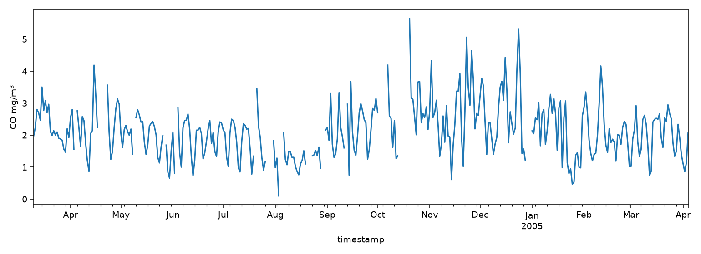
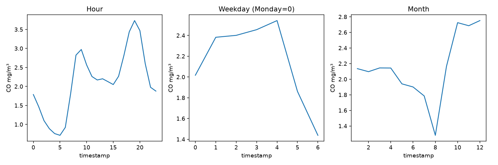
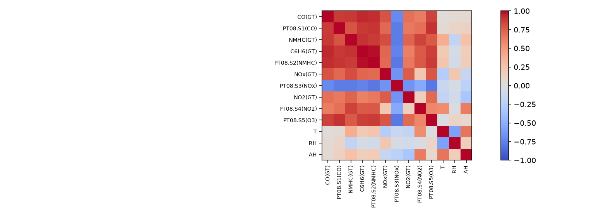
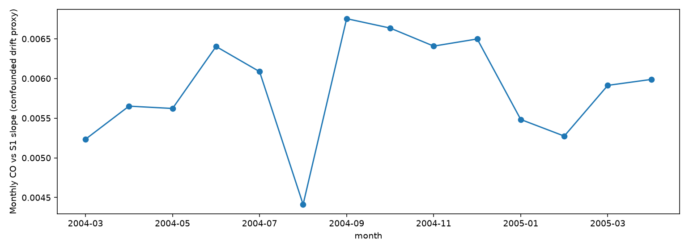

# Air quality prediction and episode detection — research

Research and planning only · 15 November 2026 · four students, 48-hour implementation budget. No application has been built. Read [PRD.md](PRD.md) for the build contract and [SOURCES.md](SOURCES.md) for evidence scope. Findings explicitly labelled “computed” come from [run.py](../research/run.py) on the downloaded real file. Design judgments and candidate explanations are not validated causal findings.

## Phase 1 — domain and problem

Estimate current CO using concurrent low-cost sensor and weather readings, compare it with the later reference observation, and explain why a residual flag may reflect unusual pollution or limitations in the data. The operational action is investigation, not a health alert.

| Dataset quantity | Plain meaning and health relevance | Source |
|---|---|---|
| CO | Carbon monoxide, a gas that reduces oxygen delivery in the body. | [WHO](https://www.who.int/teams/environment-climate-change-and-health/air-quality-and-health/health-impacts/types-of-pollutants) |
| NMHC | Non-methane hydrocarbons: a mixture rather than a single chemical. Health effects depend on composition; no single health interpretation of this aggregate is supported. | [EPA VOC effects](https://www.epa.gov/indoor-air-quality-iaq/volatile-organic-compounds-impact-indoor-air-quality) |
| C6H6 | Benzene; exposure can harm blood-related systems and is carcinogenic. | [WHO benzene report](https://www.who.int/europe/publications/i/item/WHO-EURO-2023-8983-48755-72523) |
| NOx | Nitrogen oxides, including NO and NO2; do not treat total NOx as a NO2 concentration. | [EPA NO2](https://www.epa.gov/no2-pollution/basic-information-about-no2) |
| NO2 | Nitrogen dioxide; irritates airways and can aggravate asthma. | [EPA NO2](https://www.epa.gov/no2-pollution/basic-information-about-no2) |
| PT08 sensor responses | Electrical sensor responses, not pollutant mass concentrations. S5 is nominally ozone-targeted; there is no ozone reference target in this file. Temperature and humidities are environmental covariates. | [UCI variable definitions](https://archive.ics.uci.edu/dataset/360/air+quality) |

| Framework | What it communicates | Selected values / implication | Source |
|---|---|---|---|
| WHO 2021 | Health-based concentration guidance, not an AQI scale | CO 24h: 4 mg/m³; NO2 annual: 10 µg/m³ and 24h: 25 µg/m³. An hourly spike cannot be compared directly with a daily guideline. | [WHO publication](https://www.who.int/publications/i/item/9789240034228), [guideline table](https://www.ncbi.nlm.nih.gov/books/NBK574591/table/ch3.tab26/) |
| US EPA AQI | Six health communication bands | Good 0–50; Moderate 51–100; Unhealthy for Sensitive Groups 101–150; Unhealthy 151–200; Very Unhealthy 201–300; Hazardous ≥301. Uses pollutant-specific averaging/conversion. | [AirNow basics](https://www.airnow.gov/aqi/aqi-basics/), [technical guidance](https://document.airnow.gov/technical-assistance-document-for-the-reporting-of-daily-air-quailty.pdf) |
| India National AQI | Eight-pollutant index with six bands | Good 0–50; Satisfactory 51–100; Moderate 101–200; Poor 201–300; Very Poor 301–400; Severe 401–500. | [CPCB](https://airquality.cpcb.gov.in/AQI/), [government explanation](https://ies.gov.in/arthapedia/concept/national-air-quality-index) |

MVP decision: show CO in mg/m³ and residual severity. Do not label either as AQI, “safe,” or a medical advisory. AQI conversion and other pollutants are outside this deadline.

Proposed scenarios (personas and workflow hypotheses, not observed user research):

| User | Decision | Data required | Fit now |
|---|---|---|---|
| Student environmental analyst | Which historic departures deserve inspection? | Actual, prediction, interval, residual and quality evidence | Core MVP |
| Monitoring technician | Is an odd reading associated with missing inputs or sensor disagreement? | Missing streaks, sensor/reference comparison, provenance | Core MVP, candidate diagnosis only |
| College reviewer | Does the model generalize beyond training and beat a baseline? | Split dates, all model scores, reproducible scripts | Core MVP |
| Campus activity coordinator | Whether to reschedule an outdoor event | Current local observations, validated forecasts, appropriate AQI and health guidance | Motivation for a future product; this historic Italian dataset cannot support this decision |

The eight most useful sources and one-line annotations, including the original De Vito paper, are listed first in [SOURCES.md](SOURCES.md). No original-paper performance claims are imported into this report.

## Phase 2 — existing applications and differentiation

Verification means current official documentation or app listing found on the research date. We did not install apps, test paid accounts, or measure API uptime. NV = feature not verified in reviewed documentation; it does **not** mean absent. Transparency concerns available source/measurement information, not access to proprietary model weights.

| Product and status evidence | Forecasting | Episode detection | Explains anomalies | Data transparency | Open access | Target users |
|---|---|---|---|---|---|---|
| [IQAir AirVisual](https://www.iqair.com/air-quality-monitors/air-quality-app), current product page | [7-day](https://www.iqair.com/ae/support/knowledge-base/how-can-i-access-air-quality-forecasts-through-the-airvisual-app-and-website) | NV | NV for model residual vs sensor fault | Station/location information; reproducible model NV | Public app/site; [API tiers](https://api-docs.iqair.com/?version=latest) require checking | Residents and device users, inferred from product page |
| [WAQI/AQICN](https://aqicn.org/api/), current docs | 3–8 days documented | NV | NV | Station and originating agency links | Free token/quota; usage and redistribution restrictions | Public and developers |
| [PurpleAir](https://www.purpleair.com/research/quick-guide), current guide | NV | Quality-related channel comparison available; residual episodes NV | [Two-channel graph](https://community.purpleair.com/t/how-to-use-the-map-graph/1122); causal residual explanations NV | Sensor-level particle data/map/API | Public map; [API account/access terms](https://community.purpleair.com/t/about-the-purpleair-api/7145), unrestricted free API NV | Sensor owners and researchers |
| [Google Air Quality API](https://developers.google.com/maps/documentation/air-quality/overview), current docs | Up to 96 hours | NV | Health recommendations documented; residual/fault explanations NV | Pollutant/index outputs; underlying full model reproduction NV | Cloud project required; unrestricted free use NV | Developers |
| [OpenAQ](https://docs.openaq.org/resources/measurements), current API v3 docs | Forecast feature NV in measurement API | NV | NV | Measurement and sensor resources | [Registered API key](https://docs.openaq.org/using-the-api/api-key) | Researchers/developers, inferred |
| [CPCB SAMEER](https://www.data.gov.in/catalog/sameer-national-air-quality-index), [app listed](https://play.google.com/store/apps/details?id=com.cpcb) | Forecasting NV | [Pollution complaints](https://app.cpcbccr.com/cpcb_new_marquee), automated residual episodes NV | Model residual vs fault explanation NV | Official hourly AQI context | Public app listing; reuse terms NV | Indian residents |

Three proposed differentiators, scoped to gaps **in this evidence review**, not claims of market exclusivity:

1. Each flagged episode has a readable, evidence-specific candidate classification. All six rows lack verified residual-plus-fault explanation; PurpleAir's channel context inspires rather than negates this feature. Ship as deterministic rules and an explanation panel.
2. Show estimate uncertainty, imputed-input counts and gaps together. The table's transparency column documents measurements but does not establish a comparable end-to-end residual audit. Ship one synchronized chart and quality badges.
3. Publish chronological baseline comparisons and reproducible artifacts. The table does not verify an equivalent reproducible educational benchmark in these user interfaces. Ship a performance table, split dates and source links.

## Phase 3 — hands-on dataset findings

Computed from the actual CSV, not copied from repository metadata. Source archive SHA256: `d4a64013fb385288a8a48d9d193ca7079b2e1bbddf6f8d458feb8c08ab2b8a2a`.

- Parsing: semicolon delimiter, comma decimals, `-200` to missing, explicit `%d/%m/%Y %H.%M.%S` timestamp parsing. Empty trailing columns and 114 undated trailing rows removed. Raw pandas rows: 9,471; valid dated measurements: **9,357**. This differs from UCI's stated 9,358.
- Actual bounds: **10 March 2004 18:00 to 4 April 2005 14:00**, wider than the repository's March–February description. No duplicate timestamp and no missing hourly grid slot; missing measurements exist within otherwise present hours. Source timezone/DST are [unverified]; preserve wall time without inventing UTC offsets.
- Clean output: [clean.csv](../research/data/clean.csv), 9,357 timestamped rows, 13 measurement columns, sorted. Blank cells remain missing; the reusable clean file does not contain fitted imputations.

| column | missing | percent | longest_gap_hours |
|---|---|---|---|
| CO(GT) | 1683 | 17.99% | 173 |
| PT08.S1(CO) | 366 | 3.91% | 76 |
| NMHC(GT) | 8443 | 90.23% | 8126 |
| C6H6(GT) | 366 | 3.91% | 76 |
| PT08.S2(NMHC) | 366 | 3.91% | 76 |
| NOx(GT) | 1639 | 17.52% | 173 |
| PT08.S3(NOx) | 366 | 3.91% | 76 |
| NO2(GT) | 1642 | 17.55% | 173 |
| PT08.S4(NO2) | 366 | 3.91% | 76 |
| PT08.S5(O3) | 366 | 3.91% | 76 |
| T | 366 | 3.91% | 76 |
| RH | 366 | 3.91% | 76 |
| AH | 366 | 3.91% | 76 |

Long gaps: CO has 173 consecutive missing hours from 13 October 2004 11:00 through 20 October 15:00, and 146 hours from 17 April 03:00 through 23 April 04:00. NMHC is missing for the final 8,126 hours, starting 1 May 2004 01:00. Sensor/weather channels share a 76-hour gap, 8 February 2005 17:00–11 February 20:00. These are missing-reading stretches, not proven hardware outages. Full ≥24-hour gaps per column: [gaps.json](../research/output/gaps.json).

Computed calendar patterns, using observed CO only: mean at 05:00 = 0.713 mg/m³; 09:00 = 2.972; 19:00 = 3.733. Friday mean = 2.543, Sunday = 1.438. August mean = 1.280; December = 2.751. This is consistent with within-day and seasonal variation but cannot establish traffic or weather causation. Calendar-month pooling combines partial March/April across two years; the daily chart preserves the actual chronology. Missingness can bias every aggregated pattern.

Computed pairwise-complete Pearson correlations: S1/CO = 0.879; S2/NMHC = 0.878; S3/NOx = −0.656; S4/NO2 = 0.157. The S2/NMHC figure covers only its short observed period. Negative response is not automatically a faulty sensor. See [correlations.csv](../research/output/correlations.csv) for all pairs.

Drift signs: monthly CO-versus-S1 linear slopes range approximately 0.00441 in August to 0.00675 in September; correlations include 0.947 in April 2004 and 0.843 in January 2005. This is a computed stability warning, confounded by concentration range, weather and composition; it does not isolate sensor aging. [drift_proxy.csv](../research/output/drift_proxy.csv) records monthly counts and values. The [original paper](https://doi.org/10.1016/j.snb.2007.09.060) addresses field calibration, but our proxy is not a replication.

Notable calendar window: 24–26 December 2004 has 71 observed CO hours, mean 3.552 mg/m³. A “holiday effect” is [unverified]: no holiday/event labels or causal controls are present. Do not describe Christmas, fireworks or traffic as confirmed explanations. The long October gaps and February shared-channel gap are stronger actionable evidence for this MVP than event speculation.

Choose **CO(GT)**. It has 7,674 observed reference hours (82.01%), whereas NMHC is largely unusable. Benzene is more complete, but CO offers a directly interpretable reference quantity and a public-health rationale ([WHO](https://www.who.int/teams/environment-climate-change-and-health/air-quality-and-health/health-impacts/types-of-pollutants)). Its nowcast and one-hour forecast performance are evaluated below. We did not compare ML predictability across all pollutants and do not claim CO is statistically the best target.

### Seven saved figures

## Phase 4 — revised experiments: forecast vs virtual sensor

The virtual sensor estimates CO at time t using PT08 sensor responses and weather at t, plus CO only from t−1 and earlier. Forecast uses sensor and weather data only through t−1 to predict CO at t. Same timestamps and same two baselines for both. A nowcast is not a future forecast, and concurrent sensor readings must actually be available before the estimate can be produced. Historical data cannot demonstrate live availability or performance at a new location.

Each framing uses CO lags 1, 2, 3, 24, 168 hours; past-only rolling means/std and lag difference; sensor and weather lags, rolling means/std and lag differences; cyclic hour and weekday. Forecast sensor/weather rolling windows end at t−1; nowcast ends at t. No reference pollutant at t is included as a feature. Median imputers and Ridge scalers are fit on training rows only. Rolling features are created from past/concurrent observations only; no backfill. Seasonal and persistence baselines use CO at t−24 and t−1, respectively. Actual past targets in the evaluated period become available sequentially, which is a practical limitation when a reference analyzer is unavailable for a long stretch.

Three expanding chronological evaluation folds end at the original 60% training boundary. XGBoost early stopping uses a chronological tail of each fold's **training** period; it is then refit on that fold's full training period with the chosen number of trees. The scored outer fold never controls its own stopping. Final XGBoost tree count is the median of fold selections; Ridge alpha=10. The sole selection criterion is the **unweighted mean of the three fold MAEs**, across both framings and both learned models. The pipeline writes selection.json before predicting the test period. No models are retrained on calibration or test data. The 10% threshold is applied against the better baseline under the selected framing, using the same fold average.

### Validation: unweighted mean across three rolling folds

| framing | model | n | MAE | RMSE | R2 |
|---|---|---|---|---|---|
| forecast | Persistence | 3 folds | 0.495 | 0.736 | 0.628 |
| forecast | Ridge | 3 folds | 0.408 | 0.566 | 0.783 |
| forecast | Seasonal naive | 3 folds | 0.732 | 1.036 | 0.285 |
| forecast | XGBoost | 3 folds | 0.367 | 0.530 | 0.811 |
| nowcast | Persistence | 3 folds | 0.495 | 0.736 | 0.628 |
| nowcast | Ridge | 3 folds | 0.197 | 0.268 | 0.947 |
| nowcast | Seasonal naive | 3 folds | 0.732 | 1.036 | 0.285 |
| nowcast | XGBoost | 3 folds | 0.204 | 0.294 | 0.940 |

Validation RMSE and R² above are the arithmetic means of the individual fold metrics, not pooled statistics. The folds have 585, 433 and 495 common eligible rows. Ridge nowcast MAE is 0.1966 against persistence 0.4952: **60.3% lower**. Forecast XGBoost also clears the validation threshold (0.3671 versus 0.4952). All fold-specific values and dates are in [metrics.csv](../research/output/metrics.csv).

### Final chronological test: same 1,689 eligible hours per method

| framing | model | n | MAE | RMSE | R2 |
|---|---|---|---|---|---|
| forecast | Persistence | 1689 | 0.527 | 0.817 | 0.646 |
| forecast | Seasonal naive | 1689 | 0.879 | 1.289 | 0.118 |
| forecast | Ridge | 1689 | 0.479 | 0.680 | 0.755 |
| forecast | XGBoost | 1689 | 0.486 | 0.738 | 0.711 |
| nowcast | Persistence | 1689 | 0.527 | 0.817 | 0.646 |
| nowcast | Seasonal naive | 1689 | 0.879 | 1.289 | 0.118 |
| nowcast | Ridge | 1689 | 0.281 | 0.449 | 0.893 |
| nowcast | XGBoost | 1689 | 0.333 | 0.575 | 0.824 |

Nowcast Ridge was selected on validation, and its test MAE is **46.7% lower** than persistence. The test compares all methods to satisfy the requested table; it did not determine the selection in this revised run. **Important limitation:** this same historical test period was examined during the earlier version of this project, before the revised experiments were designed. Therefore it is not a genuinely untouched independent test, even though this run freezes its selection before scoring. A future dataset or new later period is needed for an unbiased prospective confirmation.

The highest R² among individual reported folds and test rows is below 0.97. Feature provenance was still audited in code: only CO shifts of at least one hour are inputs; nowcast same-hour inputs are limited to PT08 and weather; forecast inputs are shifted. The model does not use same-hour reference CO or C6H6/NOx/NO2. Imputation and scaling are training-only. The analysis assumes all same-hour PT08 and meteorological measurements are available when the nowcast is issued; actual reporting latency is [unverified]. No guarantee follows for other sites, seasons or missing reference histories.

### Intervals and classified episodes

A later, separate chronological calibration block supplies a conformal-style nominal 90% symmetric interval, radius 0.932 mg/m³, and an absolute residual threshold 1.237 mg/m³. Empirical coverage on all 1,781 observed test targets was 94.9%; time-series dependence means coverage is not guaranteed ([conformal tutorial](https://arxiv.org/abs/2107.07511)). The common-baseline table uses 1,689 rows with both target lags available; all-observed export metrics have a different denominator. Missing actuals cannot be flagged.

The regenerated test output contains 48 flagged hours in 29 contiguous episodes: 26 data-limitation candidates and 3 unusual-pollution candidates. Flags are deviations, not diagnoses. A flag is classified as data-limitation candidate when any input was missing and imputed, prior CO history was missing, sensor range is exceeded, past sensor disagreement suggests drift, or current sensor/reference agreement is poor. Otherwise it is an unusual-pollution candidate. Saturation and drift are hypotheses; causes are unverified. All episodes include exact reasons in [episodes.json](../research/output/episodes.json). Missing observations are gaps, not flagged episodes.

[Model metadata](../research/output/model_metadata.json), [predictions](../research/output/predictions.json), [selection](../research/output/selection.json), and [reproducibility instructions](../research/README.md) document the artifact. Validation permutation feature importance and all seven charts were regenerated. The importance measures model reliance, not causation. Estimated intervals can extend below zero and are not AQI categories.

## Phase 5 — architecture

Precompute estimates and episodes in Python; serve static JSON to a JavaScript dashboard. This is feasible with four students in 48 hours, with no live inference or sensor feed. React, Vite and Recharts remain the recommended frontend ([React](https://react.dev/versions), [Vite](https://vite.dev/releases), [Recharts](https://github.com/recharts/recharts/releases/tag/v3.10.1)); [GitHub Pages](https://docs.github.com/en/pages/getting-started-with-github-pages/what-is-github-pages) is a static hosting option. API backend, ONNX conversion and TensorFlow.js retraining remain post-deadline. More detailed product requirements and the execution plan are in [PRD.md](PRD.md).

Post-deadline: independently validate on another time period/site, obtain actual sensor availability and latency, quantify missing-reference-history effects, add calibrated time-series uncertainty and validate episode causes with independent labels. [UCI](https://archive.ics.uci.edu/dataset/360/air+quality) contains conflicting research-only and CC BY statements; clarify before commercial reuse.
